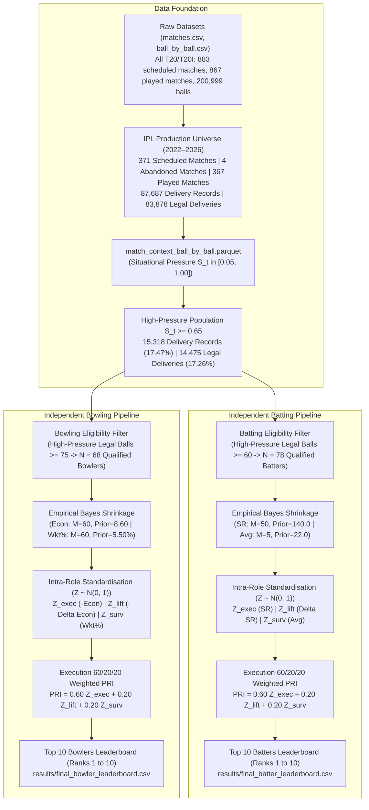

# Rajasthan Royals | SupeRR Selector Season 2 (Round 1)
# Separate Ranking Methodology: Independent Batter & Bowler Engines

---

> **Document Status**: Production-Grade & Authoritative (Reconciled Gate 3 Specification)  
> **Project Root**: `.` (RR_IPL_2027_ANALYTICS)  
> **Target Deliverable**: Authoritative Technical Methodology Document for Separate Batting and Bowling Pipelines  
> **Authors**: Senior Sports Analytics Consultant & Lead Cricket Data Scientist  

---

## 1. Executive Overview & Architectural Independence

The official competition brief for the **Rajasthan Royals SupeRR Selector Season 2 (Round 1)** specifies the submission of **two separate, ordered Top-10 leaderboards**:
1. **Top 10 Batters under Pressure**, ranked 1 through 10.
2. **Top 10 Bowlers under Pressure**, ranked 1 through 10.

To satisfy this mandate with scientific integrity, the analytical architecture separates batter evaluation from bowler evaluation into two completely independent ranking engines. 

### Strict Architectural Independence Rules:
- **No Cross-Role Contamination**: Batter scores are computed solely from batting performance events; bowler scores are computed solely from bowling performance events. No composite all-rounder list is generated.
- **Role-Specific Standardisation**: Batters are standardized strictly against the qualified universe of 78 IPL batters ($\mu_{\text{bat}} = 0, \sigma_{\text{bat}} = 1$). Bowlers are standardized strictly against the qualified universe of 68 IPL bowlers ($\mu_{\text{bw}} = 0, \sigma_{\text{bw}} = 1$).
- **Identical Pressure Substrate**: Both roles are evaluated on the exact same delivery-level situational pressure framework ($S_t \ge 0.65$), ensuring objective symmetry between batting crisis execution and bowling crisis containment.
- **IPL Production Boundary**: The official production ranking universe is strictly restricted to Indian Premier League (IPL) matches (2022–2026). Broader international T20 (T20I) data is utilized only in macroscopic context modeling, not in the production candidate leaderboards.

---

## 2. Delivery-Level Situational Pressure Formulation ($S_t$)

Situational leverage is modeled as a continuous, bounded function $S_t \in [0.05, 1.00]$ computed for each delivery $t$.

### 2.1 Innings 2: Chasing Leverage Model ($S_{2, t}$)
In run chases, pressure is governed by the Required Run Rate ($RRR_t$), wickets in hand ($W_{\text{hand}, t} = 10 - \text{wickets lost}$), legal balls remaining ($B_t$), and the scoring momentum gap ($RRR_t - CRR_t$):

$$z_{\text{chase}, t} = \left(0.45 \cdot \frac{RRR_t - \text{ParRRR}_{\text{comp}}}{4.5} + 0.35 \cdot \frac{5.0 - W_{\text{hand}, t}}{3.0} + 0.20 \cdot \frac{RRR_t - CRR_t}{4.0}\right) \times \left(0.85 + 0.95 \cdot \left(1 - \frac{B_t}{120}\right)\right)$$

$$S_{2, t} = \text{clip}\left(\sigma(z_{\text{chase}, t}), 0.05, 0.98\right) = \text{clip}\left(\frac{1}{1 + e^{-z_{\text{chase}, t}}}, 0.05, 0.98\right)$$

- **Competition Expected Par ($\text{ParRRR}_{\text{comp}}$)**: Macro seasonal par rate ($\text{Comp Par Total} / 20.0$), calibrated at the competition-season level across all completed first innings in that season. **It does not adjust for individual venue, stadium, or pitch conditions.**
- **Resource Scarcity ($W_{\text{hand}, t}$)**: As wickets fall below 5, resource scarcity accelerates pressure.
- **Time Leverage**: Scales continuously from $0.85$ at over 1 to $1.80$ at over 20, concentrating leverage into closing deliveries.
- **Terminal & Virtually Decided Match Overrides**:
  - If balls remaining $B_t \le 0$ or runs needed $\le 0$: $S_{2, t} \equiv 0.05$.
  - Needing $\le 8$ runs with $\ge 24$ balls remaining and $\ge 7$ wickets in hand: $S_{2, t} \equiv 0.08$.
  - Needing $\le 4$ runs with $\ge 5$ wickets in hand: $S_{2, t} \equiv 0.12$.
  *(Eliminates trivial, non-competitive closing deliveries from generating false high-pressure scores).*

### 2.2 Innings 1: Target-Setting Leverage Model ($S_{1, t}$)
When setting a target, pressure is driven by expected total deficit from competition seasonal par and wicket depletion:

$$\text{Projected Total}_t = \text{Score}_t + \mathbb{E}[\text{Runs Remaining} \mid \text{Over}_t, \text{Wickets Lost}_t]$$

$$z_{\text{setting}, t} = (\text{PhaseBase}_t - 0.40) \cdot 2.5 + 0.50 \cdot \left(\frac{\text{ParTotal}_{\text{comp}} - \text{Projected Total}_t}{25.0}\right) + 0.50 \cdot \left(\frac{5.0 - W_{\text{hand}, t}}{3.0}\right)$$

$$S_{1, t} = \text{clip}\left(\sigma(z_{\text{setting}, t}), 0.08, 0.95\right)$$

- **Out-of-Sample Expected Runs Remaining ($\mathbb{E}[\cdot]$)**: Calibrated via 5-fold match-level cross-fitting across completed first-innings matches with scheduled 20 overs. Matches are assigned randomly into 5 folds ($K=5$) to avoid same-match target leakage.
- **PhaseBase Urgency Baselines**: Phase scoring urgency parameters representing standard T20 tempo:
  - Powerplay (overs 1–6): $0.25$
  - Middle overs (overs 7–15): $0.40$
  - Death overs (overs 16–20): $0.60$
  *(Phase baselines establish baseline scoring expectations; they must not be confused with the overall high-pressure classification cutoff).*

### 2.3 Super Overs & External Match Stakes
- **Super Overs (Innings 3 & 4)**: Pinned strictly to maximum situational leverage: $S_t \equiv 1.00$ (6 matches, 38 deliveries).
- **Match Stakes Multipliers ($M_{\text{stakes}}$)**: In exploratory modeling, external importance factors were evaluated (IPL League = 1.10, Playoff = 1.15, Final = 1.25). **In the canonical production ranking engine (`run_independent_ranking_engines.py`), match-stakes multipliers are NOT used.** Candidate aggregation operates strictly on unweighted delivery events satisfying $S_t \ge 0.65$.

### 2.4 High-Pressure Classification ($S_t \ge 0.65$)
Deliveries with $S_t \ge 0.65$ define the high-pressure population:
- **IPL Production Universe**: Exactly **87,687 delivery records**, containing **83,878 legal deliveries**.
- **IPL High-Pressure Records**: Exactly **15,318 delivery records** ($17.47\%$ of IPL delivery records).
- **IPL High-Pressure Legal Deliveries**: Exactly **14,475 legal deliveries** ($17.26\%$ of IPL legal deliveries).
- *Accounting Distinction*: Delivery records include extras (wides and overstep no-balls), whereas legal deliveries exclude them per cricket scoring conventions.

---

## 3. Independent Batter Scoring Pipeline

### 3.1 Investigated Batting Metrics & Metric Accounting
Every qualified batter is evaluated across four core performance dimensions:
1. **High-Pressure Strike Rate ($\\text{SR}_{\\text{obs}}$)**: 
   $$\\text{SR}_{\\text{obs}} = \\left(\\frac{\\text{High-Pressure Runs Struck off Bat}}{\\text{High-Pressure Legal Balls Faced}}\\right) \\times 100$$
2. **Baseline Strike Rate ($\\text{SR}_{\\text{base}}$)**: Total tournament strike rate across all overs in IPL 2022–2026 per legal ball faced.
3. **Situational Strike Rate Lift ($\\Delta\\text{SR}$)**:
   $$\\Delta\\text{SR} = \\text{SR}_{\\text{shrunk}} - \\text{SR}_{\\text{base}}$$
4. **High-Pressure Batting Average ($\\text{Avg}_{\\text{obs}}$)**: Runs scored per batter dismissal in high-pressure deliveries.

### 3.1.1 Analytical Convention for Balls Faced vs. Conventional Cricket Scorekeeping
A vital distinction must be maintained between the project's analytical implementation and standard scorekeeping:
- **Legal Deliveries for Over Progression & Economy**: Under official cricket laws (including MCC Law 21 for no-balls and Law 22 for wides), an over consists of 6 legal deliveries. Wides and overstep no-balls must be re-bowled and do not count toward the 6 deliveries of the over. Bowling economy is calculated per 6 legal balls.
- **Batter Balls Faced in Analytical Implementation**: In this project's executable codebase (`01_build_match_context.py` and `run_independent_ranking_engines.py`), batter exposure (`tot_balls`, `high_balls`) is calculated strictly as the sum of **legal deliveries faced** (`is_legal_ball`), where:
  $$\\text{is\\_legal\\_ball} = \\neg(\\text{is\\_wide} \\lor \\text{is\\_overstep})$$
  Consequently, **both wides and overstep no-balls are excluded from the balls-faced denominator**. If a batter hits runs off a no-ball, those runs are credited to the batter's tally (`runs`), but the delivery itself does not increment the balls-faced counter.
- **Difference from Conventional Cricket Scorekeeping**: In standard cricket scorekeeping (e.g., Wisden, ESPNcricinfo), a no-ball bowled to a batter is conventionally recorded as a ball faced. The decision in this analytical pipeline to measure batting strike rate strictly per *legal delivery faced* is an **internal analytical modeling convention** adopted to preserve mathematical symmetry with bowling overs and over progression.
- **MCC Law 21 Disambiguation**: MCC Law 21 defines the conditions of a no-ball and its 1-run penalty; it does not dictate batting strike-rate conventions. Excluded no-balls from batter balls faced is an analytical convention of this project's pipeline, not an MCC Law 21 statutory rule.
- **Exact Denominators**:
  - *Batting Strike Rate Denominator*: $\\text{high\\_balls} = \\sum \\text{is\\_legal\\_ball}$ faced by the striker under $S_t \\ge 0.65$.
  - *Batter Qualification Denominator*: $\\text{high\\_balls} \\ge 60$ legal deliveries faced under $S_t \\ge 0.65$.

### 3.2 Empirical Bayes Shrinkage for Batting
To prevent small-sample distortion while preserving genuine high-pressure signals:
- **Strike Rate Shrinkage**: Regressed toward empirical prior $\mu_0 = 140.0$ SR with shrinkage parameter $M = 50.0$ legal balls:
  $$\text{SR}_{\text{shrunk}} = \frac{B \cdot \text{SR}_{\text{obs}} + 50.0 \cdot 140.0}{B + 50.0}$$
- **Batting Average Shrinkage**: Regressed toward empirical prior $\mu_0 = 22.0$ runs/out with shrinkage parameter $M = 5.0$ dismissals:
  $$\text{Avg}_{\text{shrunk}} = \frac{D \cdot \text{Avg}_{\text{obs}} + 5.0 \cdot 22.0}{D + 5.0}$$
  *(For batters with 0 dismissals, raw average equals high runs scored, regressed with $D=0$ to $(5.0 \times 22.0) / 5.0 = 22.0$).*

### 3.3 Batter Component Standardisation & PRI Formula
Component metrics are standardized into $Z$-scores within the qualified batter universe ($N = 78$):
- $Z_{\text{exec}} = (\text{SR}_{\text{shrunk}} - \mu_{\text{SR}}) / \sigma_{\text{SR}}$
- $Z_{\text{lift}} = (\Delta\text{SR} - \mu_{\Delta\text{SR}}) / \sigma_{\Delta\text{SR}}$
- $Z_{\text{surv}} = (\text{Avg}_{\text{shrunk}} - \mu_{\text{Avg}}) / \sigma_{\text{Avg}}$

**Canonical Batting PRI (60/20/20 Weighting Architecture)**:
$$\text{Raw PRI}_{\text{bat}} = 0.60 \cdot Z_{\text{exec}} + 0.20 \cdot Z_{\text{lift}} + 0.20 \cdot Z_{\text{surv}}$$
$$\text{Standardised PRI}_{\text{bat}} = \frac{\text{Raw PRI}_{\text{bat}} - \mu_{\text{PRI, bat}}}{\sigma_{\text{PRI, bat}}}$$

---

## 4. Independent Bowler Scoring Pipeline

### 4.1 Investigated Bowling Metrics & Metric Accounting
Every qualified bowler is evaluated across four core performance dimensions:
1. **High-Pressure Economy Rate ($\text{Econ}_{\text{obs}}$)**: 
   $$\text{Econ}_{\text{obs}} = \left(\frac{\text{High-Pressure Runs Conceded}}{\text{High-Pressure Legal Balls Bowled}}\right) \times 6$$
   *Metric Accounting*: Runs conceded includes runs off the bat, wides, and overstep no-ball extras. It strictly excludes byes and leg-byes.
2. **Baseline Economy Rate ($\text{Econ}_{\text{base}}$)**: Total tournament economy across all overs in IPL 2022–2026.
3. **Situational Economy Lift ($-\Delta\text{Econ}$)**:
   $$-\Delta\text{Econ} = \text{Econ}_{\text{base}} - \text{Econ}_{\text{shrunk}}$$
   *(Positive values represent superior run suppression under pressure relative to baseline).*
4. **High-Pressure Wicket Rate ($\text{WktRate}_{\text{obs}}$)**: Percentage of high-pressure legal balls yielding bowler-credited wickets:
   $$\text{WktRate}_{\text{obs}} = \left(\frac{\text{High-Pressure Bowler Wickets}}{\text{High-Pressure Legal Balls Bowled}}\right) \times 100$$
   *Metric Accounting*: Bowler wickets include `Bowled`, `Caught`, `LBW`, `Stumped`, and `Hit Wicket`. Run-outs, retired out, and obstructing the field are strictly excluded.

### 4.2 Empirical Bayes Shrinkage for Bowling
- **Economy Rate Shrinkage**: Regressed toward empirical prior $\mu_0 = 8.60$ RPO with shrinkage parameter $M = 60.0$ legal balls:
  $$\text{Econ}_{\text{shrunk}} = \frac{B \cdot \text{Econ}_{\text{obs}} + 60.0 \cdot 8.60}{B + 60.0}$$
- **Wicket Rate Shrinkage**: Regressed toward empirical prior $\mu_0 = 5.50\%$ with shrinkage parameter $M = 60.0$ legal balls:
  $$\text{WktRate}_{\text{shrunk}} = \frac{B \cdot \text{WktRate}_{\text{obs}} + 60.0 \cdot 5.50}{B + 60.0}$$

### 4.3 Bowler Component Standardisation & PRI Formula
Component metrics are standardized into $Z$-scores within the qualified bowler universe ($N = 68$):
- $Z_{\text{exec}} = (-\text{Econ}_{\text{shrunk}} - \mu_{-\text{Econ}}) / \sigma_{-\text{Econ}}$ *(Economy negated so lower economy yields positive Z)*
- $Z_{\text{lift}} = ((-\Delta\text{Econ}) - \mu_{-\Delta\text{Econ}}) / \sigma_{-\Delta\text{Econ}}$
- $Z_{\text{surv}} = (\text{WktRate}_{\text{shrunk}} - \mu_{\text{WktRate}}) / \sigma_{\text{WktRate}}$

**Canonical Bowling PRI (60/20/20 Weighting Architecture)**:
$$\text{Raw PRI}_{\text{bowl}} = 0.60 \cdot Z_{\text{exec}} + 0.20 \cdot Z_{\text{lift}} + 0.20 \cdot Z_{\text{surv}}$$
$$\text{Standardised PRI}_{\text{bowl}} = \frac{\text{Raw PRI}_{\text{bowl}} - \mu_{\text{PRI, bowl}}}{\sigma_{\text{PRI, bowl}}}$$

---

## 5. Candidate Eligibility & Sample Size Discipline

### 5.1 Qualification Cutoffs vs Shrinkage Parameters
A crucial distinction exists between **eligibility thresholds** (which define the candidate universe) and **shrinkage parameters** (which regress noisy observations toward the mean):
- **Batter Eligibility Threshold**: Minimum **60 high-pressure legal balls faced** $\rightarrow$ **78 qualified candidates**. *(Distinct from $M=50.0$ shrinkage weight).*
- **Bowler Eligibility Threshold**: Minimum **75 high-pressure legal balls bowled** $\rightarrow$ **68 qualified candidates**. *(Distinct from $M=60.0$ shrinkage weight).*
- **Combined Qualified Universe**: Exactly **146 player instances** (78 batters, 68 bowlers).

### 5.2 Statistical Power & Sample Discipline
- **Batters ($B \ge 60$)**: At 60 balls, the prior weight is $50 / (60 + 50) = 45.45\%$. This ensures that players with high strike rates have demonstrated that skill across a minimum of 4–6 separate innings. Lowering the threshold to 40 balls admits single-innings outliers; raising it to 80 balls penalizes high-impact emerging finishers (e.g., Sherfane Rutherford at 87 balls).
- **Bowlers ($B \ge 75$)**: At 75 balls (12.5 overs), the prior weight is $60 / (75 + 60) = 44.44\%$. Bowling economy has lower variance than batting strike rate; 75 balls guarantees that a bowler has operated across at least 6–8 distinct high-pressure match situations.

---

## 6. Statistical Reliability & Uncertainty Quantification

### 6.1 Cluster-Bootstrap Specification
- **1,000 Replicates**: Resampling 367 unique played IPL matches with replacement.
- **Match-Cluster Preservation**: When match $m$ is sampled $K_m$ times, all ball-by-ball deliveries within match $m$ receive integer weight $K_m$. This strictly preserves intra-match correlation, momentum swings, and pitch conditions.
- **Fixed Universe**: Evaluated strictly over the 78 qualified batters and 68 qualified bowlers.

### 6.2 Key Uncertainty Definitions
- **Top 10 Inclusion Percentage**: The empirical percentage of 1,000 resamples in which a player finishes with a rank $\le 10$. It reflects **historical sample stability across match contexts**, NOT a probability of future match success or career quality.
- **Median Bootstrap Rank**: The median rank position across the 1,000 resamples.
- **90% Empirical Rank Interval ($[P_5, P_{95}]$)**: The empirical range between the 5th percentile ($P_5$) and 95th percentile ($P_{95}$) of resampled ranks. (Contains $95\% - 5\% = 90\%$ of bootstrap observations).
- *Communicating Material Uncertainty*: 
  - Sherfane Rutherford (#1): 84.5% inclusion, Median #3, 90% rank interval **[1, 26]**.
  - Namboori Tilak Varma (#2): 75.7% inclusion, Median #5, 90% rank interval **[1, 33]**.
  - Dhruv Jurel (#6): 48.0% inclusion, Median #11, 90% rank interval **[3, 31]**.
  - Liam Livingstone (#7): 40.2% inclusion, Median #14, 90% rank interval **[2, 55]**.
  - Dinesh Karthik (#10): 43.2% inclusion, Median #13, 90% rank interval **[2, 51]**.
  - Sunil Narine (#1 Bowler): 98.3% inclusion, Median #1, 90% rank interval **[1, 7]**.
  - Mohit Sharma (#10 Bowler): 26.2% inclusion, Median #16.5, 90% rank interval **[4, 35]**.
  *(Wide rank intervals reflect authentic cricket variance and sample size constraints; they must not be described as narrow confidence bands).*

### 6.3 Disaggregated Robustness Diagnostics

To maintain scientific integrity, two distinct Leave-One-Match-Out (LOMO) concepts must never be conflated:

#### A. Pressure-Benchmark LOMO (Macro Benchmark Robustness)
- **Methodology**: Excludes 1 match at a time when calculating the competition seasonal par benchmark (`comp_par_total`) across the 367 played matches.
- **Recalculation**: Recalculates $S_t$ on all deliveries, re-filters candidate metrics, applies shrinkage, and re-ranks the fixed qualified pool.
- **Verified Findings**:
  - **Batter Top 10 Exact Ranks**: Exactly **10 out of 10 identical** (0 rank shift for all 10 batters).
  - **Bowler Top 10 Membership**: Exactly **10 out of 10 retained**, with exactly 1 rank swap between Rahul Chahar (#6 $\rightarrow$ #7) and Yuzvendra Chahal (#7 $\rightarrow$ #6).
  - **Full-Universe Stability ($N=146$)**: 145 out of 146 worst ranks are identical between original and corrected benchmarks; Kagiso Rabada (#68) shifts by 1 position (Rank 68 to 69) on non-HP match 50363.
- **Conclusion**: Confirms that the macroscopic tournament par benchmark is mathematically robust against single-match scoring anomalies.

#### B. Player-Match Influence Diagnostics (Outlier Knock Sensitivity)
- **Methodology**: Removes an individual player's single most influential match and evaluates their resulting rank drop.
- **Recalculation**: Recomputes baseline, high-pressure execution, shrinkage, and rank within the fixed pool.
- **Verified Findings**:
  - High Outlier Fragility: Liam Livingstone collapses from **Rank #7 to Rank #37** (a **30-rank drop**); Tristan Stubbs drops from **#9 to #26** (17 ranks); Dinesh Karthik drops from **#10 to #24** (14 ranks); Ashutosh Sharma drops from **#8 to #15** (7 ranks).
  - High Anchor Stability: Sherfane Rutherford drops from **#1 to #2** (1 rank drop); Sunil Narine remains **#1** (0 rank drop); Sai Kishore drops from **#2 to #3** (1 rank drop).
- **Conclusion**: Player-match influence is an essential scouting risk-management tool. A player whose rank drops precipitously when one knock is removed carries single-match outlier risk that franchises must account for in roster planning.

---

## 7. Methodological Limitations & Governance Disclosures

1. **Retrospective Evaluation vs. Real-Time Prediction**:
   - The PRI model is a retrospective performance index evaluating crisis execution in IPL 2022–2026.
   - 5-fold cross-fitting utilizes randomized match assignment rather than chronological partitioning.
   - The tournament par benchmark (`comp_par_total`) is calculated from completed matches across the season, meaning future match scoring levels in a given season inform the macro par for earlier matches.
   - Consequently, PRI evaluates historical delivery execution and should not be described as a real-time predictive forecasting model.
2. **Scouting Signals vs. Auction Acquisition Models**:
   - The rankings identify delivery-level performance traits. They do not constitute an econometric valuation model, financial bidding recommendation, or official endorsement by Rajasthan Royals.
   - Franchise acquisition decisions require integration with availability, auction pool dynamics, wage-bill optimization, overseas player slot limits, and squad balance.

---

## 8. Player Availability & Strategic Context

- **Dinesh Karthik (#10 Batter)**: Announced his formal retirement from all formats of professional cricket on June 1, 2024, and was appointed Batting Coach and Mentor of Royal Challengers Bengaluru (RCB). He is **ineligible and unavailable for the IPL 2027 auction**. His #10 ranking stands as a retrospective analytical record of his clutch finishing in 2022–2024, not an active auction target.
- **Dhruv Jurel (#6 Batter)**: Retained by Rajasthan Royals for INR 14 Crore ahead of the IPL 2025 mega-auction. While his #6 ranking reflects elite finishing capability, his 48.0% bootstrap inclusion rate, median rank of 11, and 90% rank interval of [3, 31] indicate material variance across match contexts. His ranking provides a positive scouting signal, but should not be framed as an indisputable guarantee of unpriced surplus.

---

## 9. Authoritative Production Validation Checklist

| # | Validation Rule | Source Implementation Check | Status |
| :---: | :--- | :--- | :---: |
| **1** | **Role Independence** | Batting pipeline uses zero bowling metrics; bowling pipeline uses zero batting metrics | **VERIFIED** |
| **2** | **Role Standardisation**| Batters standardized against 78 qualified batters; bowlers against 68 qualified bowlers | **VERIFIED** |
| **3** | **Top 10 Completeness**| Exactly 10 unique players in `final_batter_leaderboard.csv` and `final_bowler_leaderboard.csv` | **VERIFIED** |
| **4** | **No Duplicates** | Zero overlapping player IDs within any leaderboard | **VERIFIED** |
| **5** | **Eligibility Compliance**| All 10 batters $\ge 60$ HP legal balls; all 10 bowlers $\ge 75$ HP legal balls | **VERIFIED** |
| **6** | **Bootstrap Boundedness**| All inclusion percentages strictly $\in [0.0\%, 100.0\%]$ | **VERIFIED** |
| **7** | **Rank Interval Order** | $P_5 \le P_{10} \le \text{median} \le P_{90} \le P_{95}$ strictly satisfied across all 146 players | **VERIFIED** |
| **8** | **Metric Reproduction** | Shrunk metrics match Empirical Bayes equations with 0.000000 discrepancy | **VERIFIED** |
| **9** | **Population Accounting**| 367 played IPL matches, 87,687 delivery records, 83,878 legal balls verified | **VERIFIED** |
